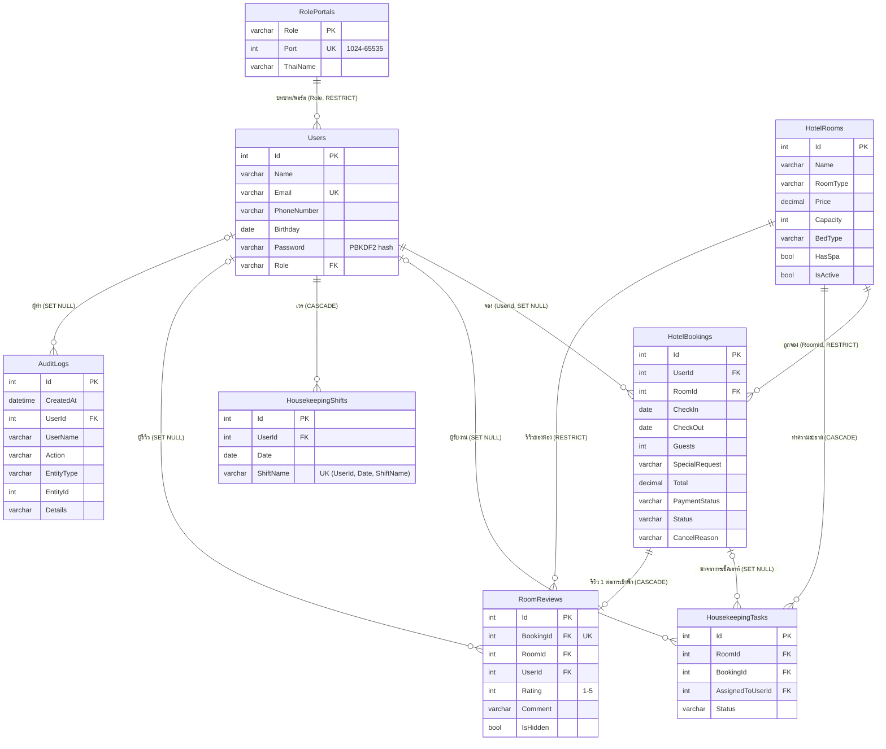

# Royal Hotel — ระบบจองห้องพักออนไลน์ (royalhotel.com)

โปรเจกต์รายวิชา CSI402 · ASP.NET Core MVC (.NET 10) + Entity Framework Core + MySQL

ลูกค้าค้นหาห้องว่าง จองพร้อมบริการเสริม ระบบคิดส่วนลดตามเงื่อนไขให้อัตโนมัติ แล้วชำระด้วยเงินสด QR Code หรือบัตร
หลังบ้านมีหน้าของพนักงานต้อนรับ แม่บ้าน ฝ่ายการเงิน ผู้ดูแลระบบ และผู้ดูแลระบบสูงสุด

---

## วิธีรัน

1. **สร้างฐานข้อมูลและบัญชีที่เว็บใช้** (ครั้งเดียว ด้วยบัญชี root ของ MySQL) — PowerShell ในโฟลเดอร์โปรเจกต์:
   ```powershell
   Get-Content -Raw Database\01_create_database.sql | & "C:\Program Files\MySQL\MySQL Server 26.7\bin\mysql.exe" -u root -p
   ```
2. **(ไม่บังคับ) ใส่ข้อมูลตัวอย่าง** จากไฟล์ dump — ไฟล์เป็น UTF-8 มีภาษาไทย ต้องสั่งให้ PowerShell อ่านและส่งเป็น UTF-8
   (ถ้าใช้คำสั่ง `Get-Content` เฉยๆ ตัวอักษรไทยทุกตัวจะกลายเป็น `?`):
   ```powershell
   $OutputEncoding = [System.Text.UTF8Encoding]::new($false)
   Get-Content -Raw -Encoding UTF8 Database\03_royalhotel_dump.sql | & "C:\Program Files\MySQL\MySQL Server 26.7\bin\mysql.exe" -u royalhotel_app -p royalhotel
   ```
   ถ้าข้ามขั้นนี้ เว็บจะสร้างตาราง ห้องพัก 3 ห้อง และบัญชีทดลองให้เองตอนเริ่มทำงาน
   และเพิ่มข้อมูลตัวอย่างชุดใหญ่ได้ด้วยคำสั่ง `dotnet run -- --seed-demo` (ดูหัวข้อ "ข้อมูลตัวอย่าง")
3. **รันเว็บ**: `dotnet run` (หรือกด F5 ใน VS Code) แล้วเปิดพอร์ตของบทบาทที่ต้องการ (ดูตารางด้านล่าง)

### แต่ละบทบาทใช้พอร์ตของตัวเอง

เว็บเปิดฟังทุกพอร์ตในโปรเซสเดียว พอร์ตของแต่ละบทบาท**ตายตัว** ไม่มีใครปรับได้

| บทบาท | URL |
|---|---|
| Customer (ลูกค้า) — หน้าเว็บสาธารณะ | http://localhost:5243 |
| Staff (พนักงานต้อนรับ) | http://localhost:5244 |
| Housekeeper (แม่บ้าน) | http://localhost:5245 |
| Finance (ฝ่ายการเงิน) | http://localhost:5246 |
| Admin (ผู้ดูแลระบบ) | http://localhost:5247 |
| Super Admin (ผู้ดูแลระบบสูงสุด) | http://localhost:5248 |

- **เปลี่ยนพอร์ตให้อัตโนมัติเมื่อเข้าสู่ระบบ**: เข้าสู่ระบบที่พอร์ตไหนก็ได้ (เช่นหน้า Log In ของเว็บลูกค้า 5243)
  ถ้าบัญชีเป็นบทบาทอื่น ระบบจะพาไปยังพอร์ตของบทบาทนั้นและเข้าสู่ระบบให้ทันที
  - ทำงานด้วย "ตั๋ว" ใช้ครั้งเดียว (`/Home/Handoff?ticket=…`) สุ่ม 256 บิต หมดอายุใน 60 วินาที ใช้ได้เฉพาะพอร์ตของบทบาทนั้น
    และใช้ได้เฉพาะเบราว์เซอร์ที่กรอกรหัสผ่าน (ผูกกับ cookie `.RoyalHotel.Browser`) ส่งลิงก์ให้คนอื่นก็เข้าสู่ระบบไม่ได้
  - ลิงก์ที่ใช้ไม่ได้จะไม่ทำให้คนที่เข้าสู่ระบบอยู่แล้วหลุดออกจากระบบ
- ถ้า Super Admin เปลี่ยนบทบาทของผู้ใช้ ในการคลิกครั้งถัดไปผู้ใช้นั้นจะถูกย้ายไปพอร์ตของบทบาทใหม่ให้อัตโนมัติ
- พอร์ตหลังบ้าน (5244–5248) ถ้ายังไม่เข้าสู่ระบบจะเห็นเฉพาะหน้า Log In และสมัครสมาชิกได้เฉพาะที่พอร์ตลูกค้า
- พอร์ตหลังบ้านแสดงเฉพาะงานของบทบาทนั้น: ไม่มีเมนูของลูกค้า แถบบนมีป้ายบอกบทบาทและพอร์ต กับลิงก์ "เว็บไซต์ลูกค้า ↗"
  โลโก้และปุ่ม "กลับหน้าหลัก" พาไปหน้าแรกของบทบาท ส่วนหน้าของลูกค้า (ห้องพัก จองห้อง ประวัติการจอง) ระบบพาไปเปิดที่พอร์ต 5243 ให้
- แต่ละพอร์ตมี session cookie ของตัวเอง (`.RoyalHotel.Session.<port>`) จึงเปิดหลายบทบาทพร้อมกันในเบราว์เซอร์เดียวกันได้ (แยกแท็บ)
- **พอร์ตปรับไม่ได้**: กำหนดไว้ในโค้ด (`Infrastructure/RolePortals.cs`) เว็บไม่สนใจ `--urls`, `ASPNETCORE_URLS` และ `applicationUrl`
  ตาราง **`RolePortals`** ในฐานข้อมูลเป็นสำเนาไว้อ้างอิง (และเป็นปลายทางของ foreign key `Users.Role`)
  ถ้ามีคนแก้ตารางนี้ เว็บไม่ได้อ่านพอร์ตจากตาราง และจะคืนค่าเดิมให้ทุกครั้งที่เริ่มทำงาน (เขียน log เตือน)
  ฐานข้อมูลบังคับเพิ่ม: พอร์ตห้ามซ้ำ (UNIQUE) อยู่ระหว่าง 1024–65535 บทบาทต้องเป็น 1 ใน 6 บทบาท และลบบทบาทที่ยังมีผู้ใช้อยู่ไม่ได้
- `appsettings.json` → `PortalHost` เลือกว่าเปิดรับที่ `localhost` (ค่าเริ่มต้น) หรือ `*` (ให้เครื่องอื่นในเครือข่ายเข้าได้) ส่วนเลขพอร์ตไม่เปลี่ยน
- เว็บให้บริการแบบ http เท่านั้น (พอร์ต https เดียวแยกบทบาทไม่ได้) เหมาะกับการรันบนเครื่อง ถ้าขึ้นเซิร์ฟเวอร์จริงให้วาง reverse proxy ที่มี TLS ไว้หน้าแต่ละพอร์ต
- โค้ด: `Infrastructure/RolePortals.cs` (พอร์ตตายตัว), `Infrastructure/LoginHandoff.cs` (ตั๋วย้ายพอร์ต), `Infrastructure/RolePortalFilter.cs` (ตรวจบทบาทกับพอร์ต),
  `Controllers/HomeController.cs` (Login / Handoff), `Models/RolePortal.cs` + `Data/DbInitializer.cs` (ตารางและการคืนค่า), `Program.cs` (เปิดพอร์ต + session แยกพอร์ต)

ค่าการเชื่อมต่ออยู่ใน `appsettings.json` → `ConnectionStrings:MySql` (รหัสผ่าน `RoyalHotel_Dev_2026` เป็นค่าเริ่มต้นสำหรับพัฒนา ตรงกับ `01_create_database.sql`)
ถ้าใช้รหัสผ่านของตัวเอง ให้ใส่ในไฟล์ `appsettings.Local.json` ข้างๆ `appsettings.json` — ไฟล์นี้ไม่อยู่ใน git และค่าในไฟล์นี้ใช้แทนค่าใน `appsettings.json`:
```json
{ "ConnectionStrings": { "MySql": "Server=localhost;Port=3306;Database=royalhotel;User=royalhotel_app;Password=<รหัสผ่าน>;CharSet=utf8mb4" } }
```
ถ้าเชื่อม MySQL ไม่ได้ ระบบจะเขียนสาเหตุและวิธีแก้ไว้ใน log ตอนเริ่มทำงาน
ต้องการใช้ไฟล์ SQLite (`cyber_users.db`) แทน MySQL ให้ตั้ง `"DatabaseProvider": "Sqlite"`
(ไฟล์นี้ไม่อยู่ใน git — ถ้ายังไม่มี ระบบจะสร้างใหม่ให้เอง พร้อมบัญชีทดลองและห้องพักตัวอย่าง)

### บัญชีทดลอง

| บทบาท | พอร์ต | อีเมล | รหัสผ่าน | หน้าแรกหลังเข้าสู่ระบบ |
|---|---|---|---|---|
| Super Admin (ผู้ดูแลระบบสูงสุด) | 5248 | admin@nightcity.net | admin123 | Dashboard |
| Admin (ผู้ดูแลระบบ) | 5247 | manager@royalhotel.com | manager123 | Dashboard |
| Staff (พนักงานต้อนรับ) | 5244 | staff@royalhotel.com | staff123 | จัดการการจอง |
| Housekeeper (แม่บ้าน) | 5245 | maid@royalhotel.com | maid123 | ห้องที่ต้องทำความสะอาด |
| Finance (ฝ่ายการเงิน) | 5246 | finance@royalhotel.com | finance123 | การเงิน |
| Customer (ลูกค้า) | 5243 | guest@nightcity.net | guest123 | หน้าแรก |

ตอนรันในโหมด Development หน้าเข้าสู่ระบบมีปุ่ม "บัญชีทดลอง" ครบทุกบทบาท กดแล้วเข้าสู่ระบบได้จากพอร์ตไหนก็ได้ (โหมด Production ไม่แสดง)
บัตรทดสอบสำหรับการชำระด้วยบัตร: `4111 1111 1111 1111` วันหมดอายุในอนาคต CVV 3 หลักใดก็ได้

### ข้อมูลตัวอย่าง

`dotnet run -- --seed-demo` ([Data/DemoDataSeeder.cs](Data/DemoDataSeeder.cs)) เพิ่มข้อมูลให้ทุกหน้ามีของให้ดู แล้วหยุดทำงาน (ไม่เปิดเว็บ):

- ห้องพักเพิ่ม 8 ห้อง (Standard / Deluxe / Suite หลายราคา รวมห้องที่ปิดปรับปรุง 1 ห้อง)
- สมาชิกตัวอย่าง 12 คน — รหัสผ่านทุกคน `demo1234` เช่น `somchai.j@example.com`, `emily.chen@example.com`
- แม่บ้านคนที่ 2: `maid2@royalhotel.com` / `maid123`
- การจองย้อนหลังประมาณ 6 เดือน (กราฟ Dashboard) และล่วงหน้า 2 เดือน: เช็คเอาท์แล้ว ยกเลิก/คืนเงิน walk-in
- สถานการณ์ของ "วันนี้": แขกกำลังเข้าพัก แขกที่ต้องเช็คเอาท์ แขกมาเช็คอิน (จ่ายแล้ว/ยังไม่จ่าย) แขกมาสาย แขกไม่มาเข้าพัก
  การโอนรอตรวจสอบ รายการรอคืนเงิน งานแม่บ้านที่รอทำ/กำลังทำ และตารางเวร 2 สัปดาห์

วันที่ทั้งหมดอิงจากวันที่รันคำสั่ง ราคาคำนวณด้วย `PriceCalculator` จริง ไม่จองซ้อนกับการจองที่มีอยู่ และรันซ้ำได้ (ครั้งที่สองจะไม่เพิ่มอะไร)

ต้องการข้อมูลเยอะขึ้นอีก: `dotnet run -- --seed-more` ([Data/BulkDataSeeder.cs](Data/BulkDataSeeder.cs)) เพิ่มห้องอีก 12 ห้อง
สมาชิกอีก 75 คน (รหัสผ่าน `demo1234`) พนักงานเพิ่ม (`staff2@`, `staff3@royalhotel.com` / `staff123`, `maid3@royalhotel.com` / `maid123`,
`finance2@royalhotel.com` / `finance123`) และเติมการจองลงทุกคืนที่ยังว่างของทุกห้อง ตั้งแต่ 12 เดือนก่อนถึง 3 เดือนข้างหน้า
(รวมแขกที่เข้าพักอยู่วันนี้) — รันซ้ำได้ ห้อง/ผู้ใช้ที่มีแล้วจะไม่เพิ่มซ้ำ และการจองจะลงเฉพาะคืนที่ยังว่าง

รีวิวตัวอย่าง: `dotnet run -- --seed-reviews` ([Data/ReviewSeeder.cs](Data/ReviewSeeder.cs)) ให้รีวิวประมาณ 1 ใน 3 ของการเข้าพักที่เช็คเอาท์แล้ว
ของสมาชิกตัวอย่าง (`@example.com` เท่านั้น ไม่แตะบัญชีจริงและแขก walk-in) แต่ละห้องมีคะแนนเฉลี่ยต่างกัน และมีรีวิวที่ซ่อนไว้ 2 รายการ
(โฆษณา และไม่สุภาพ) ให้เห็นการซ่อนรีวิว — รันได้ครั้งเดียว ครั้งต่อไปจะไม่เพิ่ม

ไฟล์ `Database/03_royalhotel_dump.sql` มีข้อมูลทั้งสามชุดแล้ว (23 ห้อง, ผู้ใช้ 100 คน, การจองประมาณ 2,400 รายการ, รีวิวประมาณ 500 รายการ)

---

## สิทธิ์และหน้าที่ของแต่ละบทบาท

| บทบาท | ทำอะไรได้ |
|---|---|
| ผู้เยี่ยมชม | ดูห้องพัก ค้นหาห้องว่างตามวันที่/จำนวนคน กรองตามประเภทห้อง/ช่วงราคา และเรียงตามราคา ความจุ หรือคะแนนรีวิว ดูรีวิวและคะแนนของแต่ละห้อง ดูช่วงวันที่ห้องไม่ว่าง ดูโปรโมชั่น สมัครสมาชิก |
| Customer | จองห้อง (2 ขั้น: รายละเอียด → ชำระเงิน ภายใน 30 นาที) พร้อมเขียนคำขอพิเศษถึงโรงแรม ดู/พิมพ์ใบยืนยัน ดู/พิมพ์ใบเสร็จรับเงิน (เมื่อชำระแล้ว) ยกเลิกการจอง รีวิวการเข้าพักหลังเช็คเอาท์ (แก้ไขได้) แก้ข้อมูลส่วนตัวและเปลี่ยนรหัสผ่าน |
| Staff | จองห้องให้แขก walk-in / จองทางโทรศัพท์ (มีหรือไม่มีบัญชีก็ได้) รับชำระเงินสด ตรวจยอดโอน เช็คอิน/เช็คเอาท์ เห็นคำขอพิเศษของแขก พิมพ์ใบเสร็จ ปิดรายการแขกไม่มาเข้าพัก แจ้งแม่บ้านทำความสะอาด |
| Housekeeper | รับงาน/ปิดงานทำความสะอาด (ปิดได้เฉพาะงานของตัวเอง) ดูเวรของตัวเอง |
| Finance | ตรวจยอดโอน บันทึกการคืนเงิน ปิดรายการที่ไม่พบยอดโอน สรุปยอดตามวิธีชำระ ดาวน์โหลด CSV เปิดใบเสร็จจากรายการรับชำระล่าสุด |
| Admin | Dashboard รายได้/การจอง/อัตราการเข้าพัก/คะแนนรีวิว จัดการห้องพักและราคา จัดเวรแม่บ้าน ซ่อน/แสดงรีวิว ดูบันทึกการกระทำ และทำงานของ Staff/Finance/Housekeeper ได้ |
| Super Admin | ทุกอย่างของ Admin และจัดการผู้ใช้ (เพิ่ม แก้ไข เปลี่ยนบทบาท ตั้งรหัสผ่านใหม่ ลบ) |

การเปลี่ยนบทบาทหรือลบบัญชีมีผลทันทีในคลิกถัดไปของผู้ใช้คนนั้น (ไม่ต้องรอให้ออกจากระบบ)

## การคิดราคา (`Models/PriceCalculator.cs`)

```
ค่าห้องพัก      = ราคาห้องต่อคืน × จำนวนคืน
ค่าบริการเสริม  = อาหารเช้า 300 × คน × คืน + เตียงเสริม 500 × คืน + สปา 1,500 × ครั้ง
ส่วนลด         = โปรโมชั่นตามเงื่อนไข (ใช้ร่วมกันได้ทุกข้อ, ไม่ทำให้ราคาติดลบ)
ภาษี 7%        = (ค่าห้อง + ค่าบริการ − ส่วนลด) × 7%
ยอดสุทธิ        = ค่าห้อง + ค่าบริการ − ส่วนลด + ภาษี
```

โปรโมชั่น: จองล่วงหน้า ≥ 30 วัน ลด 10% ของค่าห้อง · เช็คอินในเดือนเกิด ลด 10% · ห้อง Deluxe คืนวันศุกร์–เสาร์ ลด 10% · ยอดก่อนส่วนลดตั้งแต่ 10,000 บาท ลด 1,000 บาท
ราคาคำนวณที่เซิร์ฟเวอร์เสมอ และบันทึกรายละเอียดราคาไว้กับการจอง (แก้ราคาห้องภายหลังไม่กระทบการจองเดิม)

## สถานะการจองและการชำระเงิน

- การจอง: `Confirmed` (จองแล้ว) → `CheckedIn` (เข้าพักอยู่) → `CheckedOut` (เช็คเอาท์แล้ว) หรือ `Cancelled` (ยกเลิก)
- การชำระเงิน: `Unpaid` → `Pending` (แจ้งโอน QR รอตรวจ) → `Paid` · เมื่อยกเลิกการจองที่จ่ายแล้ว → `RefundPending` → `Refunded`
- **ยกเลิกได้จนถึงวันเช็คอินและได้เงินคืนเต็มจำนวน · แขกที่ไม่มาเข้าพักโดยไม่ยกเลิก (no-show) ไม่ได้เงินคืน**
  Staff กด "ปิดรายการ" ในแท็บ "ไม่มาเข้าพัก" → การจองเป็น `Cancelled` เหตุผล `NoShow` และสถานะการชำระเงินคงเดิม
  (ชำระแล้ว = รายได้ของโรงแรม · ยอดโอนที่รอตรวจ ยังยืนยัน/ปฏิเสธได้ตามปกติ) · ไฟล์ CSV ของฝ่ายการเงินมีคอลัมน์เหตุผลที่ยกเลิก
- **ต้องเลือกวิธีชำระเงินภายใน 30 นาทีหลังจอง** (เลือก "เงินสด" = จ่ายที่เคาน์เตอร์ก็ได้) ไม่เช่นนั้นระบบยกเลิกการจองอัตโนมัติและคืนห้องให้ผู้อื่น
  หน้าชำระเงินนับเวลาถอยหลังให้ · ระบบตรวจทุก 1 นาที และทุกครั้งที่เปิดหน้าชำระเงิน ประวัติการจอง หรือหน้า Staff (`Infrastructure/PaymentDeadlineService.cs`)
- ทุกการยกเลิกบันทึกเหตุผล (`CancelReason`): ลูกค้ายกเลิกเอง · พนักงานยกเลิก · แขกไม่มาเข้าพัก · ยกเลิกอัตโนมัติ (ไม่เลือกวิธีชำระ)
  แสดงในประวัติการจอง หน้า Staff และรายการรอคืนเงินของฝ่ายการเงิน
- เช็คอินได้เมื่อชำระเงินแล้ว ถึงวันเช็คอิน และแขกคนก่อนเช็คเอาท์ออกจากห้องแล้ว
- ห้องที่แม่บ้านยังทำความสะอาดไม่เสร็จ: ปุ่มเช็คอินในหน้าจัดการการจอง และ "เช็คอินทันที" ของการจอง walk-in จะเตือนและถามยืนยันก่อน
  (หน้า walk-in ระบุ "(รอทำความสะอาด)" ในรายการห้อง และขึ้นคำเตือนในกล่องสรุปราคา)
- เช็คเอาท์ → ระบบสร้างงานทำความสะอาดให้แม่บ้านอัตโนมัติ และห้องว่างให้จองได้ทันที (แม้เช็คเอาท์ก่อนกำหนด)

## ค้นหาห้อง คำขอพิเศษ และใบเสร็จ

- **ตัวกรองหน้ารวมห้องพัก** (`RoomFilterModel` ใน `Models/RoomSearchModel.cs`): ประเภทห้อง (แสดงจำนวนห้องของแต่ละประเภท) ราคาต่ำสุด/สูงสุดต่อคืน
  และเรียงตาม แนะนำ / ราคาต่ำ → สูง / ราคาสูง → ต่ำ / รองรับผู้เข้าพักมากที่สุด · ใช้ร่วมกับการค้นหาตามวันที่ได้ และค่าที่ไม่รู้จักจะถูกข้าม
  (กรองและเรียงในหน่วยความจำ เพราะห้องมีไม่มาก และ SQLite เรียงตัวเลขทศนิยมไม่ได้)
- **คำขอพิเศษ** (`HotelBookings.SpecialRequest`, ไม่เกิน 500 ตัวอักษร, ไม่บังคับ): ลูกค้าเขียนตอนจอง หรือพนักงานกรอกให้ในหน้า walk-in
  แสดงในหน้าการจองของลูกค้า และในรายการของพนักงานต้อนรับ · ระบบตัดช่องว่างหัวท้าย เก็บการขึ้นบรรทัดใหม่ (เว้นบรรทัดได้ไม่เกิน 1 บรรทัด)
- **ใบเสร็จรับเงิน** (`Models/Receipt.cs`, `Views/Shared/Receipt.cshtml`): ออกได้เมื่อการจองมีสถานะ "ชำระแล้ว" (รวมแขกไม่มาเข้าพักที่ไม่คืนเงิน)
  เลขที่ `RC-<วันที่รับเงิน>-<เลขการจอง 6 หลัก>` แยกรายการค่าห้อง อาหารเช้า เตียงเสริม สปา ส่วนลด มูลค่าก่อนภาษี VAT 7% ยอดรวม
  และจำนวนเงินเป็นตัวอักษรภาษาไทย (`ThaiBahtText` ใน `Models/Formatting.cs`) · คิดจากราคาที่บันทึกไว้กับการจอง ไม่ได้เก็บเป็นตารางแยก
  ลูกค้าเปิดที่ `Home/Receipt/{id}` (เฉพาะการจองของตัวเอง) · Staff / Finance / Admin เปิดที่ `Staff/Receipt/{id}` (รวมแขก walk-in ที่ไม่มีบัญชี)
  · ปุ่มพิมพ์ใช้ได้ทั้งพิมพ์กระดาษและบันทึกเป็น PDF (ตอนพิมพ์เหลือแค่ตัวใบเสร็จ)

## รีวิวและบันทึกการกระทำ

- **รีวิว** (ตาราง `RoomReviews`, `Models/RoomReview.cs`): ลูกค้ารีวิวได้หลังเช็คเอาท์ 1 รีวิวต่อการเข้าพัก (UNIQUE BookingId) ให้ 1–5 ดาว
  (CHECK) และความเห็นไม่เกิน 1,000 ตัวอักษร แก้ไขภายหลังได้ (มีป้าย "แก้ไขแล้ว") เข้าที่ปุ่ม "รีวิว" ในประวัติการจองหรือหน้าการจอง
  · ชื่อที่แสดงเป็นชื่อต้น + อักษรแรกของนามสกุล (เช่น "สมชาย ใ.") เพื่อความเป็นส่วนตัว
  · หน้าห้องพักแสดงคะแนนเฉลี่ย จำนวนรีวิว กราฟแยกตามดาว และรีวิวล่าสุด 6 รายการ (กด "ดูรีวิวทั้งหมด" ได้) · การ์ดห้องแสดงดาวและจำนวนรีวิว
    และเรียงห้องตาม "คะแนนรีวิวสูงสุด" ได้
  · Admin / Super Admin ซ่อนรีวิวที่ไม่สุภาพหรือเป็นโฆษณาได้ที่ "รีวิวจากผู้เข้าพัก" (`Admin/Reviews`) — รีวิวที่ซ่อนไม่แสดงและไม่นับคะแนน
    ลูกค้ายังแก้ไขได้แต่ยังคงถูกซ่อน
- **บันทึกการกระทำ** (ตาราง `AuditLogs`, `Models/AuditLog.cs`, หน้า `Admin/AuditLog` สำหรับ Admin / Super Admin):
  บันทึกว่าใครทำอะไรกับรายการไหน เมื่อไร จาก IP ใด ครอบคลุม 29 การกระทำ — จองให้แขก walk-in, ยืนยันยอดโอน, รับเงินสด, ปฏิเสธการโอน,
  เช็คอิน/เอาท์, ยกเลิก (พนักงาน/ลูกค้า/อัตโนมัติ), ปิดรายการไม่มาเข้าพัก, คืนเงิน, ดาวน์โหลด CSV, งานแม่บ้าน, เวร, เพิ่ม/แก้/ลบห้อง
  (เก็บค่าเดิม → ค่าใหม่ เช่น ราคา), เพิ่ม/แก้/ลบผู้ใช้, เปลี่ยนบทบาท, ตั้ง/เปลี่ยนรหัสผ่าน, ซ่อน/แสดงรีวิว
  · บันทึกใน transaction เดียวกับการเปลี่ยนแปลง (มีการเปลี่ยนแปลงโดยไม่มีบันทึกไม่ได้) · การกระทำที่ถูกปฏิเสธไม่ถูกบันทึก
  · เพิ่มได้อย่างเดียว ไม่มีหน้าแก้หรือลบ · ไม่บันทึกรหัสผ่านหรือเลขบัตร · ชื่อและบทบาทของผู้ทำถูกคัดลอกไว้ จึงยังอ่านได้แม้ลบบัญชีไปแล้ว
  · กรองตามประเภท ผู้ทำ ช่วงวันที่ และค้นหา (#เลขที่ / ชื่อ / คำ) · ปุ่ม "ประวัติ" ในหน้าจัดการการจองและหน้าจัดการผู้ใช้เปิดประวัติของรายการนั้น
  · การยกเลิกอัตโนมัติ (ไม่เลือกวิธีชำระใน 30 นาที) บันทึกในชื่อ "ระบบอัตโนมัติ" ครั้งเดียวต่อการจอง แม้หลายหน้าตรวจพร้อมกัน

---

## ฐานข้อมูล (MySQL `royalhotel`)



- **Foreign key** ทุกความสัมพันธ์ (ดู ON DELETE ในแผนภาพ) — ห้องที่มีประวัติการจองลบไม่ได้ ให้ปิดการใช้งานแทน
- **CHECK constraint** (ฐานข้อมูลปฏิเสธค่าผิดเอง แม้แก้ข้อมูลตรงที่ MySQL)
  - ค่าที่ต้องอยู่ในรายการ: บทบาท สถานะการจอง สถานะการชำระเงิน วิธีชำระเงิน (หรือว่าง = ยังไม่เลือก) เหตุผลที่ยกเลิก ประเภทห้อง ประเภทเตียง สถานะงานแม่บ้าน ช่วงเวร การกระทำและประเภทรายการในบันทึกการกระทำ
  - ตัวเลข: ราคาห้อง > 0 ความจุ 1–10 คน วันเช็คเอาท์ > วันเช็คอิน จำนวนคืน 1–30 ผู้เข้าพัก 1–10 คน สปา 0–10 ครั้ง ยอดเงินทุกช่องไม่ติดลบ พอร์ต 1024–65535 ดาวรีวิว 1–5
- **วันที่ล้วน** (วันเช็คอิน/เช็คเอาท์ วันเกิด วันเข้าเวร) เป็นชนิด `DATE` จึงไม่มีเวลาติดมา · เวลาที่เกิดเหตุการณ์ (จองเมื่อ ชำระเมื่อ เช็คอินเมื่อ) เป็น `DATETIME`
- **Index** สำหรับค้นหาห้องว่าง (RoomId, CheckIn, CheckOut) การจองของสมาชิก สถานะการจอง/การชำระเงิน และงานแม่บ้าน
- **ไม่ซ้ำ (UNIQUE)**: อีเมลผู้ใช้ · เวรของแม่บ้านหนึ่งคนในวันและช่วงเดียวกัน · รีวิวหนึ่งรายการต่อการจอง · **ชื่อห้อง** ไม่ซ้ำ (ตรวจในโค้ดตอนบันทึกห้อง)
- ชื่อห้อง/ชื่อผู้เข้าพักถูกเก็บสำเนาไว้กับการจองด้วย เพื่อให้ประวัติยังอ่านได้แม้แก้ไขหรือปิดห้องภายหลัง

ไฟล์ในโฟลเดอร์ `Database/`

| ไฟล์ | ใช้ทำอะไร |
|---|---|
| `01_create_database.sql` | สร้างฐานข้อมูล `royalhotel` (utf8mb4) และบัญชี `royalhotel_app` — รันด้วย root ครั้งเดียว |
| `02_schema.sql` | สร้างตารางทั้งหมดในฐานข้อมูลว่าง (สร้างจาก EF model: `dotnet run -- --print-schema`) |
| `03_royalhotel_dump.sql` | สำรอง/กู้คืนตารางพร้อมข้อมูลตัวอย่าง (รหัสผ่านเป็น hash) |

ปกติไม่ต้องรัน 02 เอง: ตอนเริ่มทำงานเว็บจะสร้างตารางที่ยังไม่มี (ตารางที่เพิ่มภายหลัง เช่น `RoomReviews`, `AuditLogs` ใช้ SQL ที่ EF สร้างจาก model
เดียวกับฐานข้อมูลใหม่ ทั้ง MySQL และ SQLite) และอัปเกรดฐานข้อมูลรุ่นเก่า (เพิ่มคอลัมน์ใหม่ index, foreign key, CHECK
และเปลี่ยนคอลัมน์วันที่ล้วนจาก DATETIME เป็น DATE) ให้อัตโนมัติ (`Data/DbInitializer.cs`) โดยข้อมูลเดิมอยู่ครบ
ยกเว้นตาราง `Promotions` (รหัสโปรโมชั่นแบบเก่าที่เลิกใช้แล้ว โปรโมชั่นตอนนี้เป็นกฎใน `Models/PriceCalculator.cs`) ซึ่งถูกลบออก
ขั้นที่ข้อมูลเก่าขัดกับกฎ (เช่น มีเวรซ้ำ หรือวันที่มีเวลาติดอยู่) จะถูกข้ามและเขียน log เตือน เว็บยังทำงานต่อได้

## ความปลอดภัย

- รหัสผ่านเก็บเป็น hash แบบ PBKDF2 + salt (ASP.NET Core Identity `PasswordHasher`) — รหัสผ่านเก่าที่เป็นข้อความธรรมดาถูกแปลงอัตโนมัติ
- ทุกฟอร์ม POST ต้องมี anti-forgery token · จำกัดการล็อกอิน/สมัครสมาชิก 20 ครั้งต่อนาทีต่อ IP (`Security:LoginAttemptsPerMinute`)
- ตรวจสิทธิ์ทุก action ฝั่งเซิร์ฟเวอร์ และตรวจ session กับฐานข้อมูลทุกคำขอ (`Infrastructure/CurrentUserFilter.cs`)
- ลูกค้าเห็น/แก้ได้เฉพาะการจองของตัวเอง · ราคาและยอดเงินคำนวณที่เซิร์ฟเวอร์เท่านั้น
- การจองห้องทำใน transaction ที่ล็อกแถวของห้อง (`SELECT … FOR UPDATE`) จึงไม่เกิดการจองซ้อนแม้กดจองพร้อมกัน
- กดพร้อมกันหลายคนก็ไม่พัง: แม่บ้านสองคนกด "รับงาน" งานเดียวกัน ได้คนเดียว (`UPDATE … WHERE Status = 'Pending'`)
  สมัครด้วยอีเมลเดียวกันหรือเพิ่มเวรซ้ำพร้อมกัน ฐานข้อมูลเก็บไว้รายการเดียว อีกฝั่งได้ข้อความแจ้ง (ไม่ใช่หน้า error)
  ชำระเงินตรงกับตอนครบ 30 นาทีพอดี: ล็อกแถวการจองก่อนบันทึก ผลจึงเป็นอย่างใดอย่างหนึ่ง (ชำระทัน หรือถูกยกเลิก) ไม่มีการจองที่ถูกยกเลิกแต่จ่ายเงินแล้ว
- ไม่เก็บเลขบัตรเต็ม วันหมดอายุ และ CVV (เก็บแค่ 4 หลักท้าย) · ตรวจเลขบัตรด้วย Luhn check
- Security headers (`X-Content-Type-Options`, `X-Frame-Options`, `Referrer-Policy`) และไม่ให้เบราว์เซอร์แคชหน้าที่มีข้อมูลส่วนตัว
- CSV ที่ดาวน์โหลดกัน formula injection (เซลล์ที่ขึ้นต้นด้วย = + - @)

## โครงสร้างโปรเจกต์

```
Controllers/     Home (หน้าลูกค้า จอง ชำระเงิน ล็อกอิน) · Account · Staff · Housekeeping · Finance · Admin · SuperAdmin
Models/          entity (CyberUser, HotelRoom, HotelBooking, Housekeeping, RoomReview, AuditLog…) · ฟอร์ม · PriceCalculator · Receipt · PasswordSecurity · ค่าคงที่
Data/            ApplicationDbContext (ตาราง FK CHECK index) · DbInitializer (สร้าง/อัปเกรด/ข้อมูลเริ่มต้น) · BookingQueries
Infrastructure/  CurrentUserFilter · RolePortals / RolePortalFilter / LoginHandoff (พอร์ตตามบทบาท)
                 PaymentDeadlineService (ยกเลิกการจองที่ไม่เลือกวิธีชำระ) · ViewHelpers
Views/           หน้าเว็บ (Razor) · Shared/_Layout (ผู้เยี่ยมชม) · _Layout2 (ผู้ใช้ที่ล็อกอิน มีเมนูตามบทบาท)
wwwroot/         site.css · auth.css · site.js · img/
Database/        สคริปต์ MySQL
```
